# Module Evaluation Questionnaires (MEQ)

## Information for teachers

Students can provide feedback to teachers to recognise good practice and help improve teaching.

General information about MEQs is available on the relevant [student page on MEQ](../../../student/MEQ).

This page provides additional information relevant to teachers.

### Create an MEQ

An MEQ is a special type of Set. It can be created in the _Content_ tab of a module in TEACHER mode. MEQs use templates that are controlled centrally on the tenant (e.g. school or university). 

To modify or extend the available templates, or the default date and time for opening and closing an MEQ, speak to your administrator.

When you add an MEQ from a template, the following can be edited:

- Name of the MEQ
- Visibility (Opening and closing dates; and 'manually hidden' toggle) 
- Which teachers from the module are evaluated (if any)

Once an MEQ has been created, it becomes a separate copy; future changes to the central templates will not appear in the MEQ you have created. The only options to edit the MEQ are the above listed properties. 

There is no limit to the number of MEQs that can be created in a module.

### Teacher-specific questions

The template question includes general content and response areas that are tailored to the questionnaire environment. One option for each response area is to designate a question as 

_'Repeat statements for each teacher'_

For questions with this toggle, the question repeats identically for each teacher listed in the MEQ settings. The default setting is no teachers, and the teachers need to be manually added in the settings by selecting from teachers who are enrolled on the module.

### Student enrollment

Students must be enrolled on a module on Lambda Feedback for them to access any and all MEQ on that module. A full guide to enrollment is [here](enrolling_students.md).

### Data visibility

An [overview of data visibility](../../../student/MEQ#access-to-meq-data) is provided on the student page on MEQ. The moderator(s) for each module are set by the Administrators, and are visible on the _Teachers_ tab in the module in TEACHER mode.

### Adding Evaluated Teachers to MEQs

To add evaluated teachers, select the **Content** tab within a module, and click on the 'Update settings' button (a cog) for an MEQ:

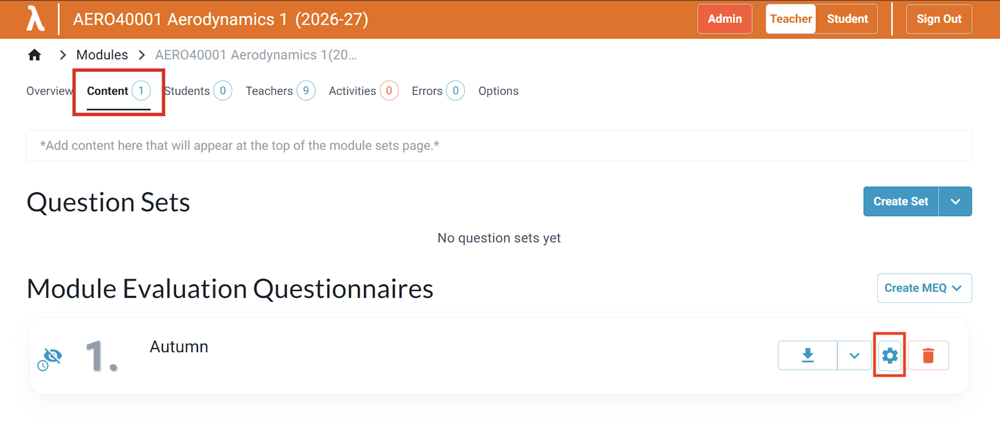

Start typing a name in the **Evaluated Teachers** box, select the teacher from the list, and save.

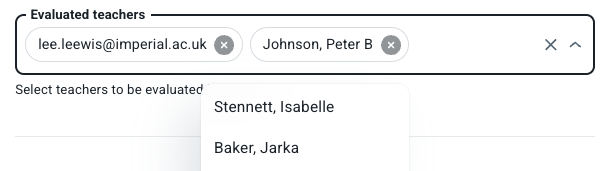

Evaluated teachers are set per MEQ. They are a subset of the teachers on the module and appear only in the settings of that MEQ.

### Moderators

Moderators (who approve comments before teachers can see them) are listed on the **Teachers** tab. Moderators can only* be allocated by ADMIN users.

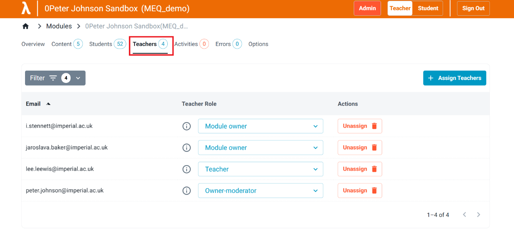

(*) The choice of who can allocate moderators is set for each tenant. It could be different on different tenants. One approach is to restrict moderator allocation to ADMIN users only.

### Monitoring Student Engagement with MEQs

Response rates for MEQs are visible in the following places in TEACHER mode:
- Inside the MEQ, on the 'STATS' tab, which opens by default
- On the 'Content' tab within a module
- On the 'Overview' tab

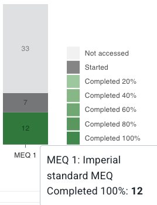

Non-responsive students can be identified in the 'Students' tab using the filter. Note in the image below:
- Filter by Set, select 'Have not accessed', and select a Set by name
- Note in the example, 52 students on the module (displayed on the tab), but only 33 students after filtering

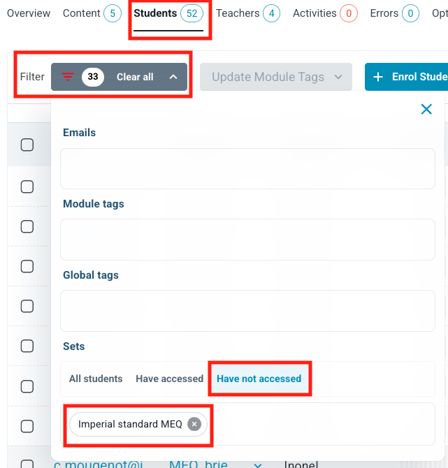{width=50%}

Once filtered, the email addresses can be copied to clipboard and pasted into an email client (e.g. Outlook), or exported as a CSV:

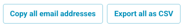

## Optional: Editing MEQ Titles and Dates

The Education Systems Team sets MEQ titles and opening and closing dates at generation. Changes are rarely needed. Agree any date changes with the Education Systems Team before generation where possible, because changes made after generation must be applied to each MEQ separately.

<!-- TODO: a page listing all MEQs on one page is due to launch; update this section to use it once available. -->

### Editing an MEQ title

1. From your dashboard, select the module.

    <!-- TODO: replace screenshot; the highlighted module is a sandbox and differs from the module used in later screenshots. -->
    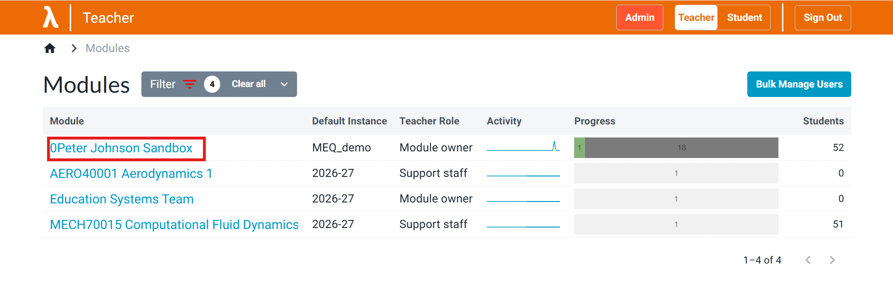

2. Select **Content** in the top navigation bar. This lists the MEQs in the module.

    <!-- TODO: replace screenshot; it shows a question set, not an MEQ set. -->
    

3. Select the **Settings** icon next to the MEQ and change the name in the pop-up.

    <!-- TODO: replace screenshot with one using the title 'Autumn'. -->
    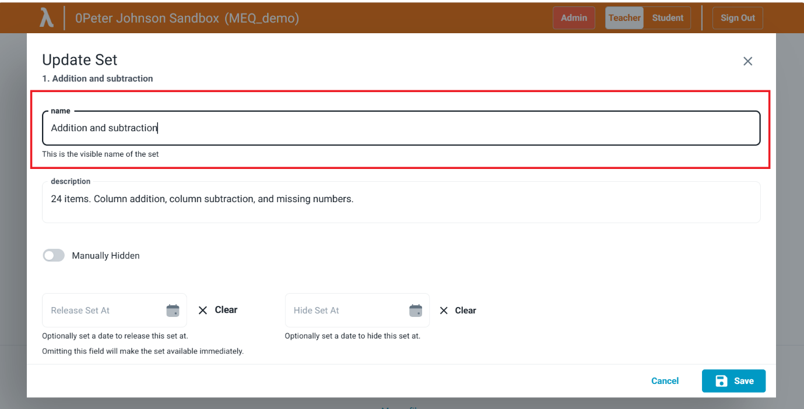

Alternatively, hover next to the MEQ name until a pencil icon appears, then select the pencil to edit the name.

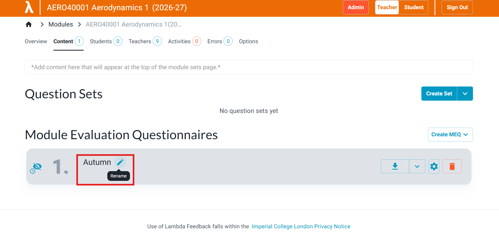

### Changing opening and closing dates

1. From your dashboard, select the module.
2. Select **Content** in the top navigation bar.
3. Select the **Settings** icon next to the MEQ.

    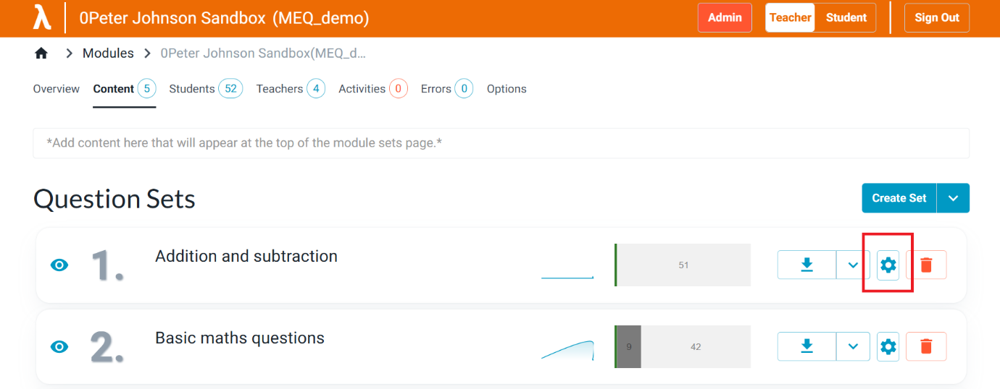

4. Update the opening and closing dates and select **Save**.

    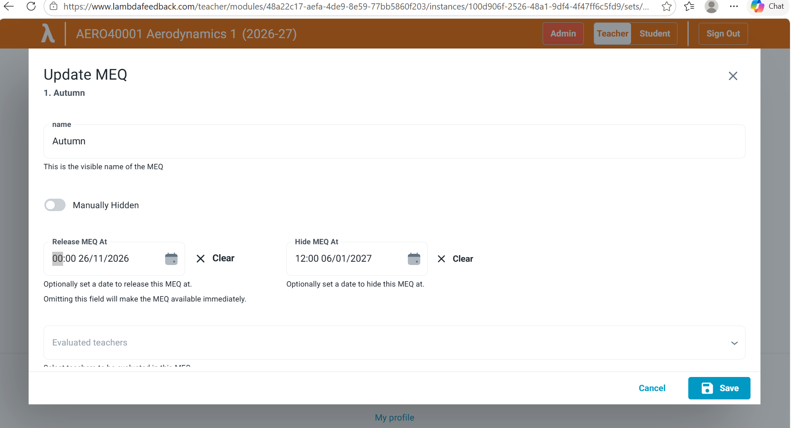

## Information for students

See also, [MEQ for students](../../../student/MEQ).

