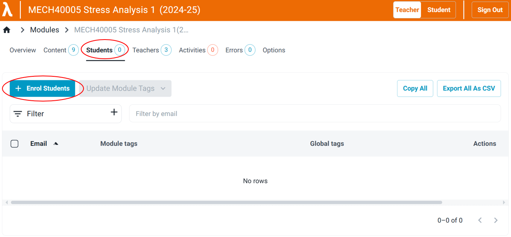
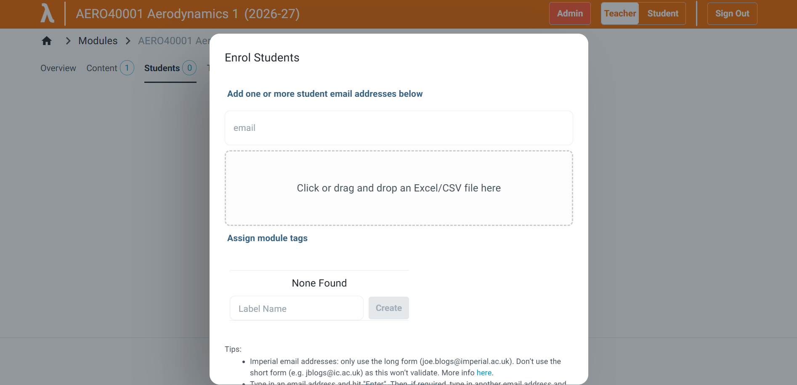
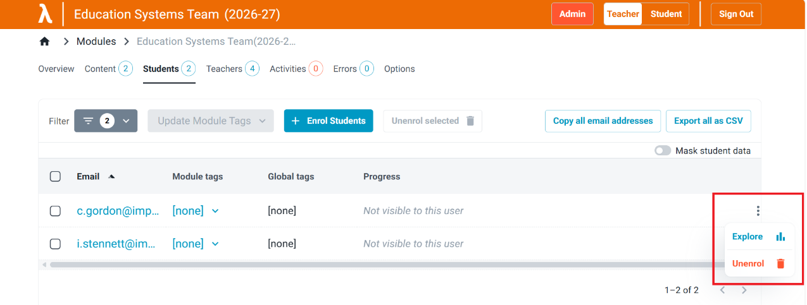
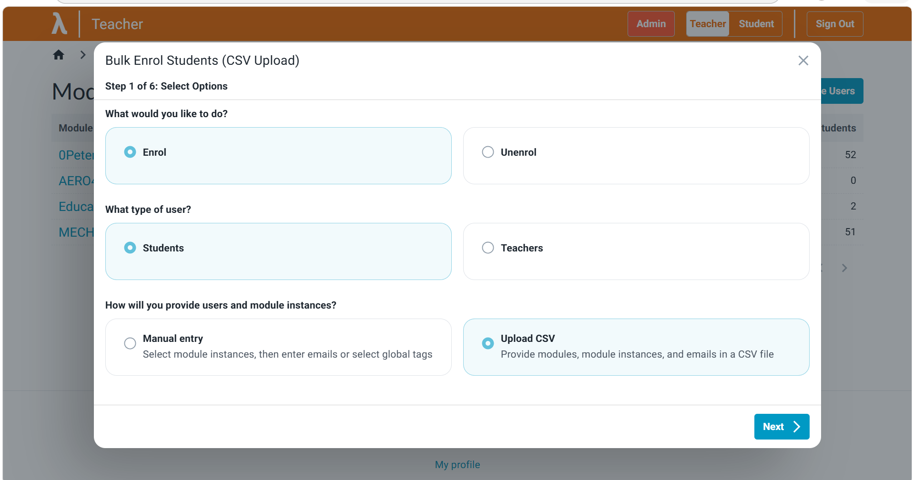
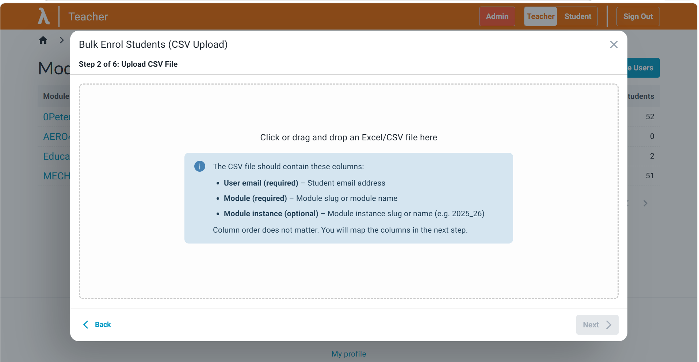
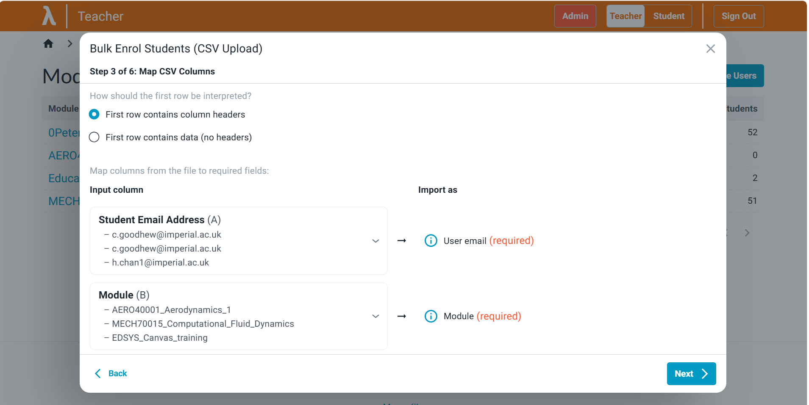
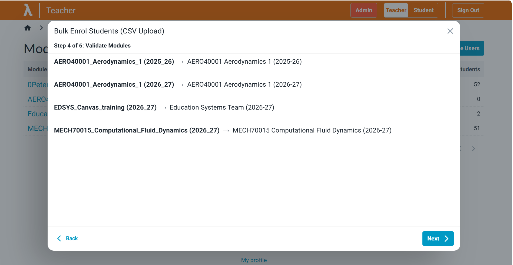
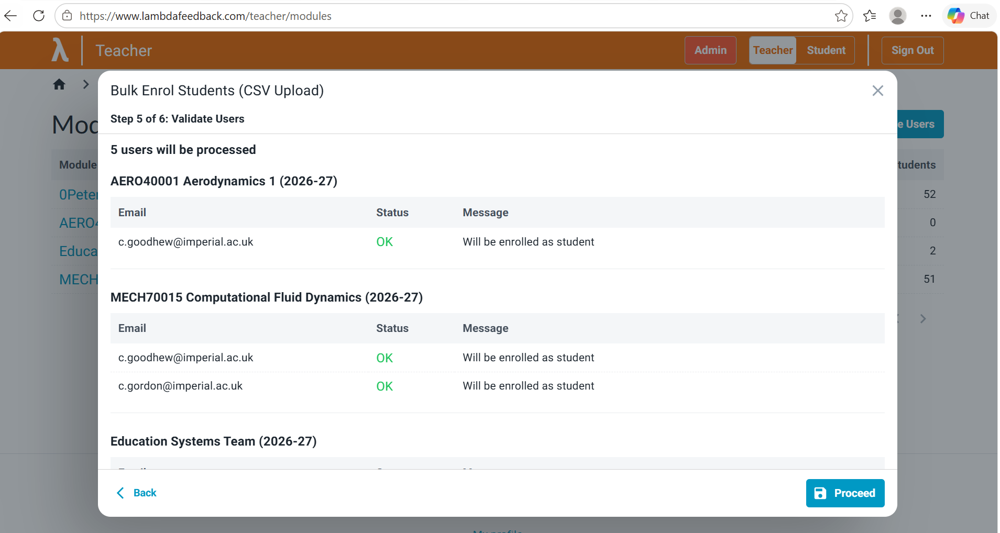
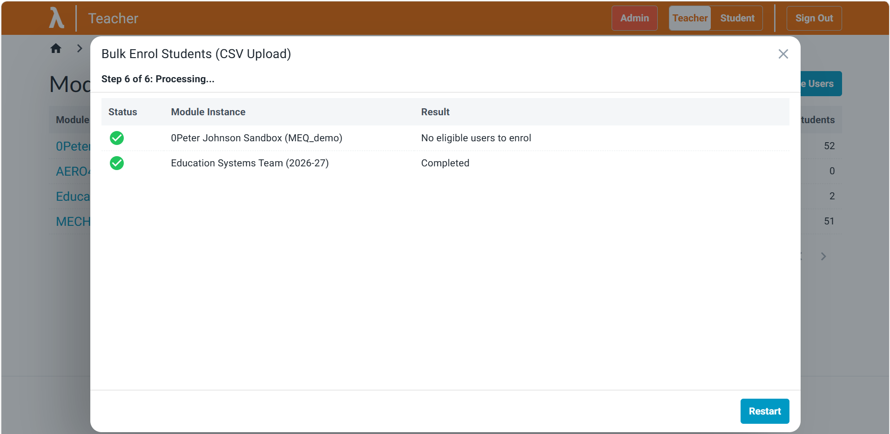

# Enrolling students

## Correct form of email address

The email address must be the one returned by the authentication process. For Imperial College London this means the *long-form email address*:

#### Valid:

first.nameYY@imperial.ac.uk (student)
 
j.doe@imperial.ac.uk (staff)
 
first.name@imperial.ac.uk (staff)
 

#### Invalid:

abc123@ic.ac.uk
 
abc123@imperial.ac.uk
 
user@ic.ac.uk
 
user@imperial.ac.uk
 
first.nameYY@ic.ac.uk
 

This is because we use Azure Active Directory (i.e., Microsoft) to **authorise** users.

## Enrollment within a module

In the module, open the **Students** tab and select **+ Enrol Students**.

Type the student's long-form email address in the **email** box, press **Enter**, and select **Submit**. Alternatively, upload a CSV with a list of email addresses.

A student can be unenrolled by selecting them (LHS) and clicking 'Unenrol selected', or clicking the three dots on the RHS of the student and clicking 'Unenrol'.

## Bulk enrol across multiple modules

Click on 'Bulk manage users', which is on the [modules](https://www.lambdafeedback.com/teacher/modules) page.

Follow the guidance on the screen to provide the data in a CSV file. A preview is provided before exectuing.

Select **Enrol**, **Students** and **Upload CSV**.

Upload the prepared file.

Configure the data. A file that follows the mock example needs little configuration.

Check that each row maps to the correct module.

Confirm the enrolments and proceed.

The enrolments show as processing until all are complete.

