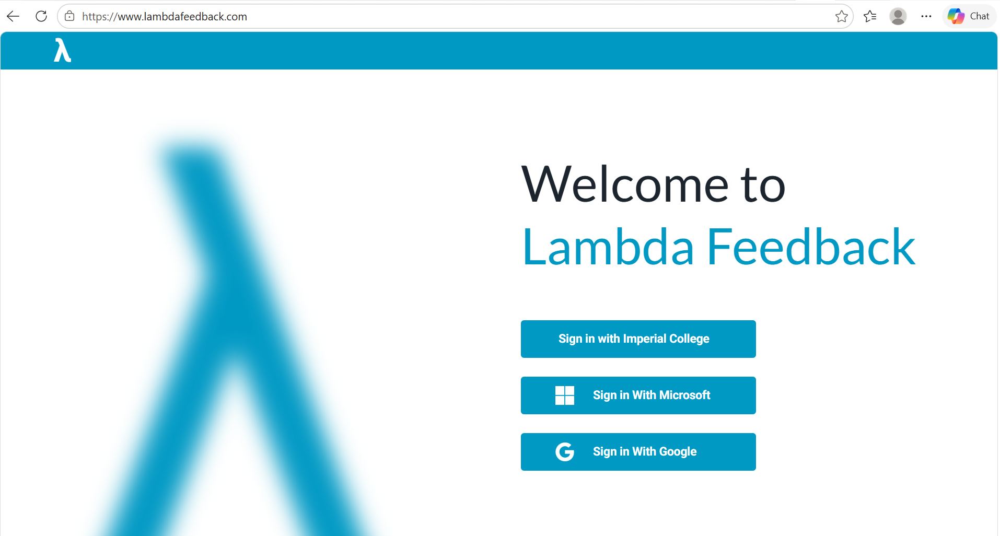
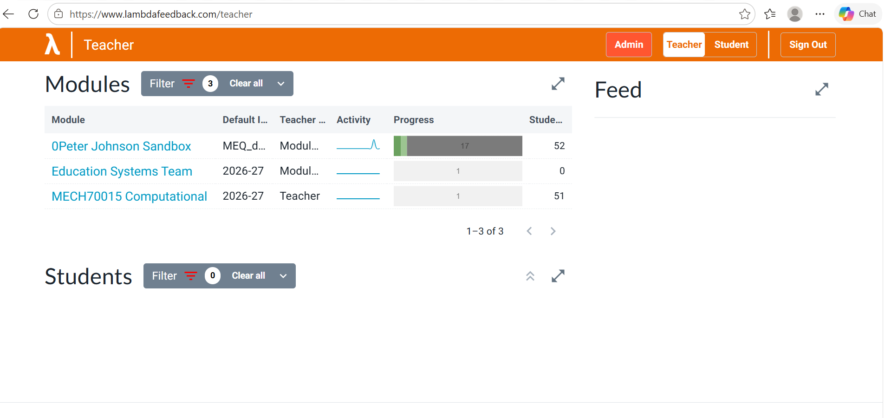
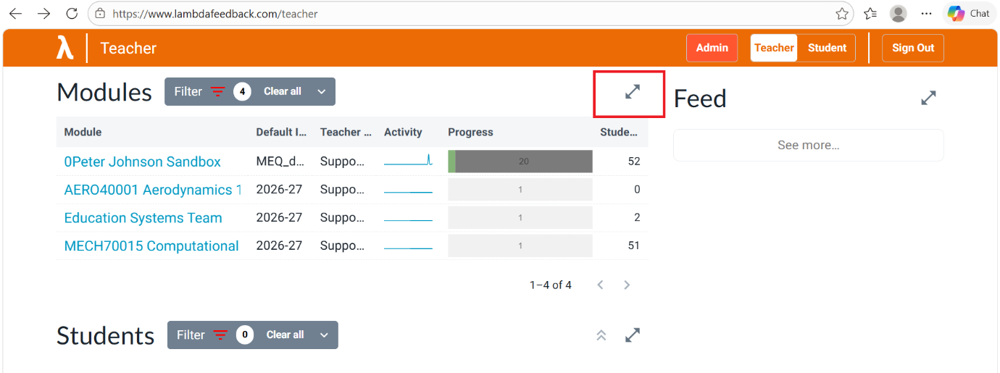
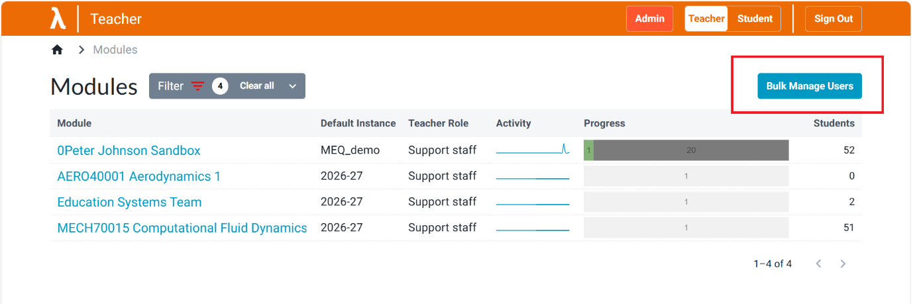
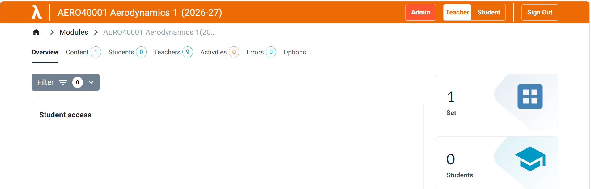
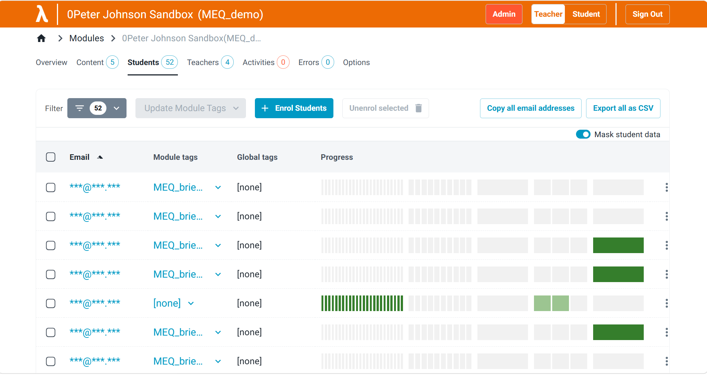
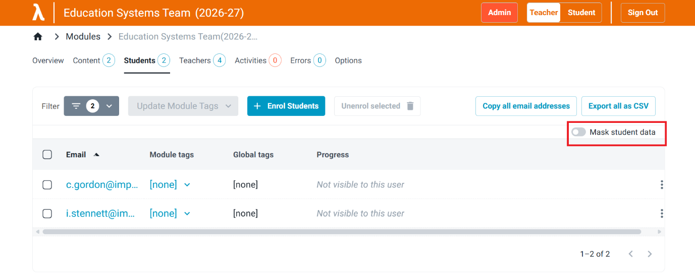
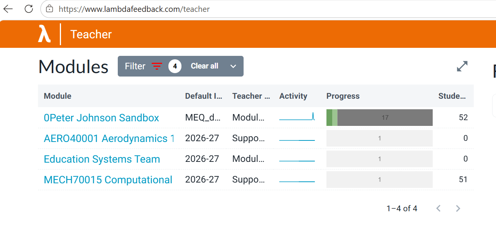
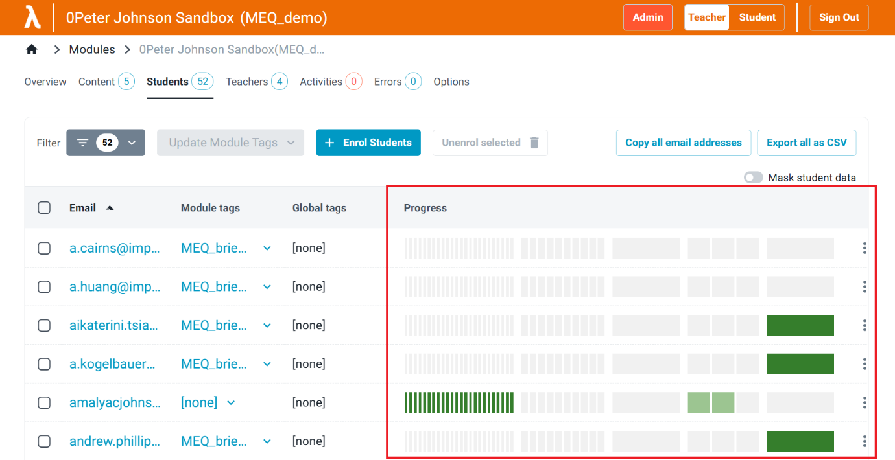

# Lambda Feedback MEQ Guidance for Support Staff

## What is Lambda Feedback?

Lambda Feedback is a Faculty of Engineering feedback platform. Aeronautics and Mechanical Engineering already use it for Module Evaluation Questionnaires (MEQs).

Each MEQ combines Likert-scale questions with free-text feedback on the module and on each evaluated teacher. Students and staff sign in at [www.lambdafeedback.com](https://www.lambdafeedback.com) with Imperial College SSO. Students see all of their MEQs in one place.

Support Staff make sure each MEQ has the right students, evaluated teachers, title, and opening and closing dates.

## Support Staff Timeline (Autumn 2026 MEQs)

| Date | Project stage | Action required |
|---|---|---|
| 21.10.26 | MEQ data ready | Add or confirm the **long-form** email addresses of module leads and evaluated teachers in the [MEQ Enrolment Dataset](https://imperiallondon.sharepoint.com/sites/FoE_EdTech_Lab/EdSys%20Team/Projects/6.%20Lambda%20Feedback%20MEQs/MEQ%20Generation%20CSVs/MEQ_enrolment_dataset.xlsx?web=1) for your department. |
| 23.10.26 | MEQs generated | No action for Support Staff. The Education Systems Team generates the MEQs. |
| End of October | Configuration | Confirm that all of your department's MEQs are present in Lambda Feedback. Check the opening and closing dates. The Education Systems Team sets these at generation, so changes are rarely needed. Confirm access arrangements for Canvas and non-Canvas courses with the Education Systems Team. |
| Mid November (about 1 week before MEQs go live) | Student enrolments | Extract student enrolment data from Banner and enrol the students on the relevant modules. Verify the enrolments, with particular attention to electives, exchange students, I-Explore/IDX and late module changes. The Education Systems Team shares MEQ links with students via Canvas. |
| Late November | MEQs go live | Departments launch their MEQs and promote them to students. The Education Systems Team provides first-line support for access, permissions, configuration and system issues. |
| Late November to early December | MEQs are live | Departments monitor student engagement and encourage completion. |

## Logging in to Lambda Feedback

Support Staff and evaluated teachers log in as follows:

1. Go to [www.lambdafeedback.com](https://www.lambdafeedback.com/).

    

2. Select **Sign in with Imperial College**.
3. Sign in with your SSO details.
4. The dashboard lists all the modules you support.
5. Select a module to see its content, teachers, students and activity.

    

After generation, Support Staff cannot change the questions in an MEQ. Support Staff can:

- add evaluated teachers
- enrol and unenrol students
- monitor student response rates once MEQs are live
- edit MEQ titles and opening and closing dates, if required

## Adding Evaluated Teachers to MEQs

!!! important
    Evaluated teachers whose **long-form** email address is in the [MEQ Enrolment Dataset](https://imperiallondon.sharepoint.com/:x:/r/sites/FoE_EdTech_Lab/EdSys%20Team/Projects/6.%20Lambda%20Feedback%20MEQs/MEQ%20Generation%20CSVs/MEQ_enrolment_dataset.xlsx?d=wa732d017213049a88b050f4cea35dd4a&csf=1&web=1&e=ggjpv7) by **21 October 2026** are added to the relevant MEQs automatically at generation.

To add further evaluated teachers:

1. From your dashboard, select the module.
2. Select **Content** in the top navigation bar. This lists the MEQs in the module.

    

3. Select the **Settings** icon next to the MEQ.

    

4. Start typing a name in the **Evaluated Teachers** box, select the teacher from the list, and save.

    <!-- TODO: replace screenshot with one showing the drop-down list of teachers after typing a name. -->
    

Evaluated teachers are set per MEQ. They are a subset of the teachers on the module and appear only in the settings of that MEQ.

Moderators are set per module, not per MEQ. The Education Systems Team adds moderators separately, before or after MEQ generation. Support Staff cannot add moderators. The **Teachers** tab of each module lists its moderators.

## Enrolling Students on Modules

Students are enrolled on modules, not on individual MEQs. A student enrolled on a module has access to that module's MEQs.

!!! note
    Student enrolment status changes during term. Enrol students at least 1 week before the MEQs go live, so that the Banner data is current.

Support Staff enrol students and verify the enrolments. Use **long-form** email addresses (for example `joe.bloggs@imperial.ac.uk`). Short-form addresses (for example `jb123@ic.ac.uk`) fail validation.

### Enrolling students on several modules at once

1. Use Banner to prepare a CSV or Excel file of student long-form email addresses. See the [mock example](https://imperiallondon.sharepoint.com/:x:/s/FoE_EdTech_Lab/IQCHk3DchX6ERIa6QuST44qOAQzSOiF3GHa0OcMLzFInjHw?e=VONPIv).

    <!-- TODO: confirm the mock example has been tested. Its module names use underscores and do not match the module names shown in Lambda Feedback; if matching is by module slug, say so here. -->

2. Go to [www.lambdafeedback.com/teachers/modules](https://www.lambdafeedback.com/teachers/modules), or expand the Modules page from the Teacher dashboard.

    

3. Select **Bulk Manage Users**.

    

4. Select **Enrol**, **Students** and **Upload CSV**.

    

5. Upload the prepared file.

    

6. Configure the data. A file that follows the mock example needs little configuration.

    

7. Check that each row maps to the correct module.

    

8. Confirm the enrolments and proceed.

    

9. The enrolments show as processing until all are complete.

    

### Enrolling students on a single module

1. From your dashboard, select the module.

    

2. Select the **Students** tab, then **+ Enrol Students**.

    

3. Drag and drop the prepared student file into the upload box, then scroll down and select **Submit**.

    

4. The enrolled students appear in the **Students** tab in Teacher mode.

Verify student enrolments with the Education Systems Team before the MEQs go live in late November.

### Enrolling an individual student

After a bulk enrolment, individual students may still need adding.

1. In the module, open the **Students** tab and select **+ Enrol Students**.

    

2. Type the student's long-form email address in the **email** box, press **Enter**, and select **Submit**.

    

### Unenrolling an individual student

1. In the module, open the **Students** tab. This lists the enrolled students.

    

2. Select the three dots next to the student and choose **Un-enrol**.

    

!!! note
    If student email addresses are hidden, switch off **Mask Student Data**.

    

## Monitoring Student Engagement with MEQs

Support Staff can track MEQ completion rates and follow up where engagement is low.

!!! important
    If an MEQ receives fewer than five responses, its results stay hidden to protect anonymity, and the academics receive no feedback.

1. The dashboard lists the modules you support.

    

2. Each module shows an activity graph of when students were active, and a progress bar of completion:
    - **Dark green**: students who have completed the MEQ.
    - **Light green**: students who have completed at least 40% of the MEQ.
    - **Grey**: students who have started the MEQ but completed less than 40%.
3. The number next to the progress bar is the total number of enrolled students.
4. If engagement is still low 1 week into the 2-week MEQ period, follow up with the module team. Response rates rise when academics give students time in a lecture or tutorial to complete the MEQ.

The **Students** tab of a module shows each student's progress. A filter on this tab lists the students who have not accessed a specific MEQ.

<!-- TODO: replace screenshot with a module that contains only an MEQ set; this one shows several sets. -->

## Optional: Editing MEQ Titles and Dates

The Education Systems Team sets MEQ titles and opening and closing dates at generation. Changes are rarely needed. Agree any date changes with the Education Systems Team before generation where possible, because changes made after generation must be applied to each MEQ separately.

<!-- TODO: a page listing all MEQs on one page is due to launch; update this section to use it once available. -->

### Editing an MEQ title

1. From your dashboard, select the module.

    <!-- TODO: replace screenshot; the highlighted module is a sandbox and differs from the module used in later screenshots. -->
    

2. Select **Content** in the top navigation bar. This lists the MEQs in the module.

    <!-- TODO: replace screenshot; it shows a question set, not an MEQ set. -->
    

3. Select the **Settings** icon next to the MEQ and change the name in the pop-up.

    <!-- TODO: replace screenshot with one using the title 'Autumn'. -->
    

Alternatively, hover next to the MEQ name until a pencil icon appears, then select the pencil to edit the name.

### Changing opening and closing dates

1. From your dashboard, select the module.
2. Select **Content** in the top navigation bar.
3. Select the **Settings** icon next to the MEQ.

    

4. Update the opening and closing dates and select **Save**.

    

## Further Support

Contact the Education Systems and Delivery Team at [engineering.learningtech@imperial.ac.uk](mailto:engineering.learningtech@imperial.ac.uk).
